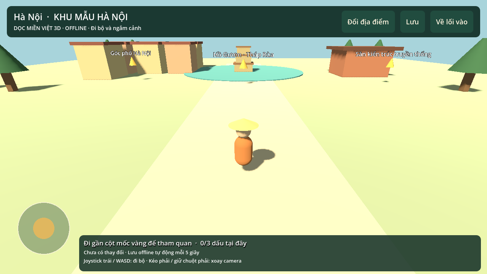
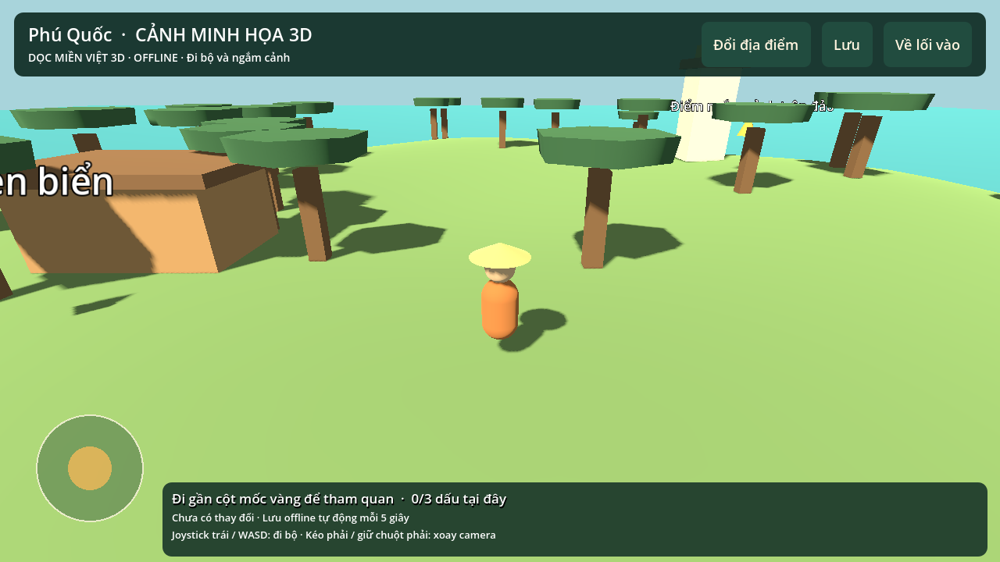

# Dọc miền Việt — các bản thử nghiệm

## Bản mới: khám phá 3D 0.2.0

[⬇ Tải APK Dọc miền Việt 3D](./doc-mien-viet-3d-0.2.0.apk) · [Mã nguồn dự án Godot](./doc-mien-viet-3d-source-0.2.0.zip)

APK khoảng52MB, Android7+ có OpenGL ES3, ARM64/ARM32. Cài và mở **Dọc miền Việt 3D**; app này cài riêng với bản quiz cũ. Joystick trái để đi bộ, kéo bên phải để xoay camera, đến gần cột mốc để khám phá. Chơi và lưu dữ liệu offline; không cần Expo Go/Metro. Bản release ký khóa thử nghiệm nội bộ.

Đã có nhân vật di chuyển, camera, va chạm, POI và47 khu có thể vào (34tỉnh/thành +13vùngđảo). **Các cảnh chủ yếu là minh họa sinh thủ tục, chưa số hóa thực địa.13vùngđảo chưa phải tất cả đảo có tên của Việt Nam.** Đây là nền tảng thử nghiệm theo hướng mới, không phải bản nội dung toàn quốc đã hoàn thiện. Chưa kiểm thử trên điện thoại thật hoặc iOS.

[Chi tiết kiểm chứng](docs/VALIDATION_3D.md) · [Phạm vi địa lý còn thiếu](docs/GEOGRAPHIC_SCOPE.md)

## Bản cũ: quiz 0.1.0

[APK prototype quiz cũ](./doc-mien-viet-0.1.0.apk) — giữ để tham khảo, không còn là hướng gameplay chính.

Nếu GitHub mở trang xem file thay vì tải ngay, chọn **Download raw file** (biểu tượng↓). Checksum trong SHA256SUMS.
