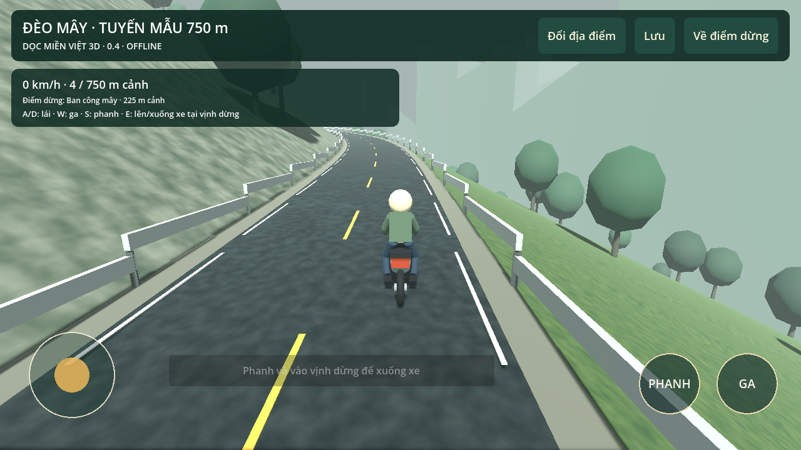
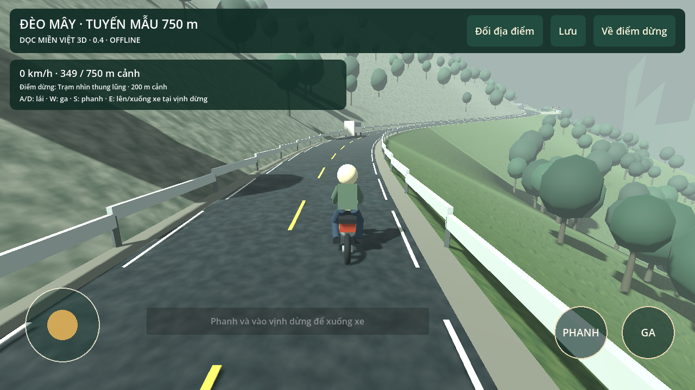
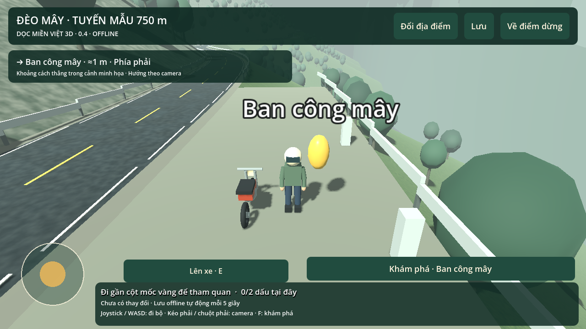

# Dọc miền Việt 3D — bản thử nghiệm

## Mới nhất: 0.4.0 · Tuyến đèo và xe máy

[⬇ Tải APK 0.4.0](./doc-mien-viet-3d-0.4.0.apk) · [Source ZIP 0.4](./doc-mien-viet-3d-source-0.4.0.zip)

[Source đang phát triển: codex-work](https://github.com/BachVu89/TravelVietnamese/tree/codex-work) · [Báo cáo BA hiện tại](https://github.com/BachVu89/TravelVietnamese/blob/codex-work/docs/STATUS_REPORT.md)

**Cách vào:** mở Dọc miền Việt 3D → Đổi địa điểm → LÁI XE TRÊN ĐÈO MÂY. Touch: joystick lái, GA/PHANH. Bàn phím: A/D lái, W ga, S phanh, E lên/xuống xe tại vịnh khi đã dừng, F khám phá khi đi bộ gần cột mốc.

Tuyến mẫu khoảng750đơn vịscene, có3xe traffic/va chạm và2vịnh dừng để xuống đi bộ. Về điểm dừng phục hồi checkpoint đã qua. Chơi offline; Android7+, ARM64/ARM32/OpenGL ES3, APK khoảng52MB. Cùng appID/chứng thư với0.3, versionCode4; chưa thử cài đè trên điện thoại thật.

**Đây là prototype kỹ thuật, đồ họa còn cách điệu và chưa đạt ảnh tham chiếu.** Tuyến sinh thủ tục, không phải dữ liệu khảo sát Khánh Lê.417assertion+desktoploop đã đạt; chưa đo FPS/RAM/nhiệt hay kiểm thử Android/iOS thực. Photo mode chưa có.

[Chi tiết kiểm chứng0.4](docs/VALIDATION_0.4.md) · [Phạm vi địa lý](docs/GEOGRAPHIC_SCOPE.md) · [Backlog PO](docs/PRODUCT_BACKLOG.md)

## Phạm vi Việt Nam

Danh mục giữ34tỉnh/thành+13vùngđảo; scene chủ yếu minh họa sinh thủ tục, chưa đủ mọi đảo có tên và chưa tái hiện địa hình thực. Tuyến lái mẫu là mục riêng, không phải tỉnh/đảo thứ48.

## Bản trước

[3D0.3.0](./doc-mien-viet-3d-0.3.0.apk) · [Source0.3](./doc-mien-viet-3d-source-0.3.0.zip) · [3D0.2.0](./doc-mien-viet-3d-0.2.0.apk) · [Quiz0.1](./doc-mien-viet-0.1.0.apk)

Nếu GitHub mở trang xem file, chọn **Download raw file** (↓). Checksum trong SHA256SUMS.
