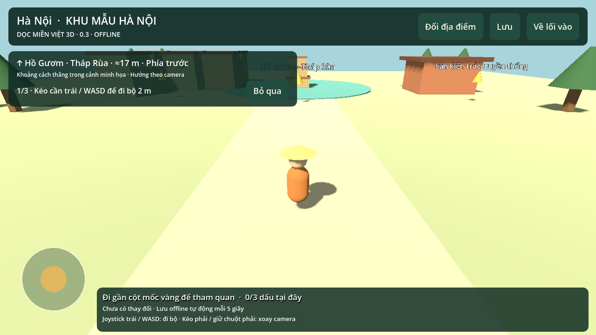
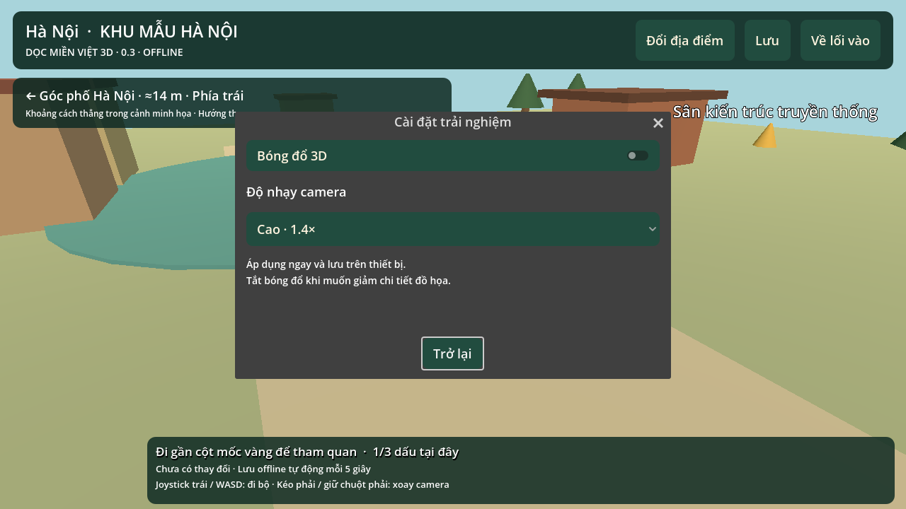

# Dọc miền Việt 3D — bản thử nghiệm

## Mới nhất: 0.3.0, cải tiến theo Product Owner

[⬇ Tải APK 3D 0.3.0](./doc-mien-viet-3d-0.3.0.apk) · [Mã nguồn Godot 0.3](./doc-mien-viet-3d-source-0.3.0.zip)

Android7+, ARM64/ARM32 và OpenGL ES3, khoảng52MB. APK giữ cùng appID/chứng thư ký với0.2 và tăng versionCode; có thể dùng để cập nhật bản3D0.2. Chưa thử cài đè trên điện thoại thật. Mở **Dọc miền Việt 3D**, khác app quiz0.1. Chơi offline, không cần Expo Go/Metro.

Ba cải tiến đã triển khai:
- Hướng dẫn bằng thao tác đi bộ, nhìn và tương tác thật; có bỏ qua, xem lại và lưu từng bước.
- Chỉ tới điểm tham quan chưa ghé gần nhất, có hướng/khoảng cách trong cảnh và tiến trình cục bộ.
- Tùy chọn bóng đổ và độ nhạy camera, giữ qua chuyển cảnh/khởi động lại.

[Team và vai trò Product Owner](docs/TEAM.md) · [Nghiên cứu có nguồn](docs/market/RESEARCH.md) · [Backlog và ưu tiên tiếp theo](docs/PRODUCT_BACKLOG.md) · [Bằng chứng kiểm tra0.3](docs/VALIDATION_0.3.md)

Nghiên cứu hiện là benchmark định tính sản phẩm lân cận, chưa có khảo sát thị trường/người chơi đại diện. Đã qua257assertion và renderdesktop; chưa kiểm trên điện thoại/iOS, chưa đo FPS.

## Phạm vi nội dung

47khu vào được (34tỉnh/thành+13vùngđảo). Cảnh chủ yếu minh họa sinh thủ tục, **chưa số hóa thực địa và chưa đủ mọi đảo có tên của Việt Nam**. Ưu tiên kế tiếp là dữ liệu đảo có nguồn kiểm chứng và cảnh đặc trưng từng địa danh. [Phạm vi địa lý](docs/GEOGRAPHIC_SCOPE.md).

## Bản trước

[3D0.2.0](./doc-mien-viet-3d-0.2.0.apk) · [Source0.2](./doc-mien-viet-3d-source-0.2.0.zip) · [Quiz0.1 cũ](./doc-mien-viet-0.1.0.apk)

Chọn **Download raw file** (↓) nếu GitHub mở trang xem file. Checksum trong SHA256SUMS.
