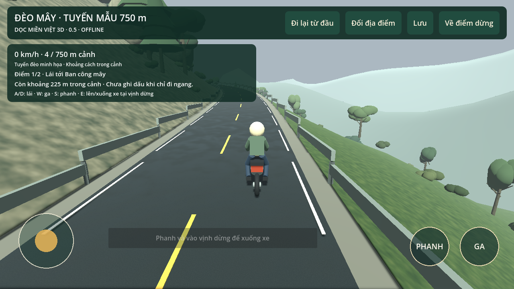

# Dọc miền Việt 3D — bản thử nghiệm

## Mới nhất: 0.5.0

[⬇ Tải APK 0.5.0](./doc-mien-viet-3d-0.5.0.apk) · [Source ZIP 0.5](./doc-mien-viet-3d-source-0.5.0.zip)

[Source: codex-work](https://github.com/BachVu89/TravelVietnamese/tree/codex-work) · [Báo cáo BA](https://github.com/BachVu89/TravelVietnamese/blob/codex-work/docs/STATUS_REPORT.md)

**Cách vào:** mở game → Chơi đèo mẫu. Joystick lái, GA/PHANH; dừng tại vịnh để xuống xe, đi bộ khám phá và lên xe tiếp tục. HUD hướng dẫn lần lượt hai điểm dừng và đích. Đi lại từ đầu giữ dấu đã khám phá. Cài đặt có Tiết kiệm/Chi tiết và bóng đổ độc lập.

0.5 cải thiện mặt đường, đá, cây/bụi và núi nền. Chơi offline; Android 7+, ARM64/ARM32/OpenGL ES3, APK khoảng 52 MB. Cùng package/chứng thư với 0.4, versionCode 5; metadata cập nhật đã kiểm, chưa cài đè trên điện thoại thật.

**Đồ họa vẫn là prototype cách điệu, chưa đạt ảnh tham chiếu.** Tuyến minh họa sinh thủ tục, không phải khảo sát Khánh Lê. 466 kiểm tra/13 suite và vòng GUI điều khiển xe→đỗ→đi bộ→khám phá→lên xe đạt trên desktop. Chưa thử Oppo Find X7 Ultra/iPhone 13, chưa đo FPS/RAM/nhiệt/đa chạm. Chưa có IPA ký cho iOS; photo album chưa có.

[Kiểm chứng 0.5](docs/VALIDATION_0.5.md) · [Ảnh đối chiếu](docs/ART_COMPARE_0.5.md) · [Phạm vi địa lý](docs/GEOGRAPHIC_SCOPE.md)

## Phạm vi Việt Nam

Danh mục có 34 tỉnh/thành + 13 vùng đảo. Cảnh chủ yếu minh họa, chưa đủ mọi đảo có tên hoặc địa hình thực. Catalog đảo có nguồn và khoảng thiếu là ưu tiên tiếp theo.

## Bản trước

[3D 0.4](./doc-mien-viet-3d-0.4.0.apk) · [Source 0.4](./doc-mien-viet-3d-source-0.4.0.zip) · [3D 0.3](./doc-mien-viet-3d-0.3.0.apk) · [Source 0.3](./doc-mien-viet-3d-source-0.3.0.zip) · [3D 0.2](./doc-mien-viet-3d-0.2.0.apk) · [Quiz 0.1](./doc-mien-viet-0.1.0.apk)

Nếu GitHub mở trang xem file, chọn **Download raw file** (↓). Checksum trong SHA256SUMS.
