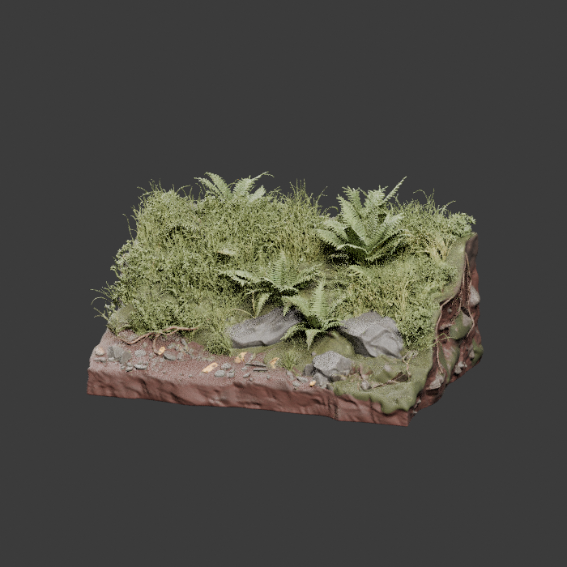

# Intake — Meshy Floating Fern Terraces

Ngày kiểm tra: **08/11/2026**. Phạm vi: tải 14 volume người dùng cung cấp, ghép đúng thứ tự, kiểm tra archive và giải nén dữ liệu. **Intake hoàn tất; sau đó root đã cho phép một lượt Blender inspection. Đã render ba góc, chưa import engine/đổi scene.**

## Kết quả

- Có **1 FBX + 4 PNG**, không phải 14 asset riêng.
- Archive ngoài 7z chứa một ZIP; ZIP chứa đúng FBX/PNG thuộc whitelist. Không chạy script đính kèm hoặc import asset vào Unity/Godot.
- Helper `scripts/art/unpack-meshy-volumes.py` kiểm tra số volume liên tiếp/cùng family, đường dẫn an toàn, không symlink/special entry, giới hạn mỗi file dưới 2 GiB và đọc đầy đủ dữ liệu qua libarchive. Kết thúc `ARCHIVE_READ_COMPLETE 1`.
- ZIP được kiểm tiếp bằng `zipfile`: từ chối traversal, absolute path, backslash, symlink, file mã hóa và đụng tên khi flatten; giới hạn file dưới 2 GiB/tổng dưới 8 GiB. Đọc hết từng entry nên CRC ZIP được kiểm, kích thước khớp; kết thúc `NESTED_SAFE_EXTRACTION_CRC_PASS 5`.
- PNG được đọc header và `verify()` bằng Pillow: tất cả **2048 × 2048**. CRC/hash chứng minh nhất quán dữ liệu, không chứng minh quyền sử dụng hoặc nguồn phát hành.

## Staging local — không commit raw

- Volume tải về: `/workspace/attachments/…/Meshy_AI_Floating_Fern_Terraces_20261108_texture_fbx_2.7z.001` đến `.014`; mapping local tại `/tmp/fern-downloads.json`.
- Kiểm header ban đầu: `/tmp/library/fern-intake/preflight.7z` (bản ghép staging, chưa xóa).
- Ghép/manifest/extraction: `/tmp/meshy-fern-terraces/`.
- `joined.7z`, `parts.json`, `extracted-files.json`: archive ngoài và manifest.
- `extracted/Meshy_AI_Floating_Fern_Terraces_20261108_texture_fbx.zip`: ZIP gốc bên trong.
- `raw/`: 5 file đã flatten, `nested-files.json` ghi tên gốc/CRC/SHA/dimensions; `nested-archive.json` ghi SHA ZIP.
- Các đường dẫn `/tmp` và attachments chỉ là staging của phiên, không phải tài nguyên đã đóng gói hoặc kho lưu trữ lâu dài.

## Manifest 14 volume

Family: `Meshy_AI_Floating_Fern_Terraces_20261108_texture_fbx_2.7z`. Tải theo các batch tối đa bốn, dùng `Promise.allSettled` và kiểm mọi kết quả. **14/14 thành công**.

| Volume | Bytes | SHA-256 |
| --- | ---: | --- |
| 001 | 25165824 | `378ae2b6f1ebe0c9a0bd9c8cc8a1940cf88d63a27ca38855d96681dd8736a1e0` |
| 002 | 25165824 | `4766e8f948462dc9d6d55cfb9b7fda588f63826cc80c9a89de21daafbfbf1e7d` |
| 003 | 25165824 | `70f67adad76016c7973a97e2230eab9b10e06cb373c3e2de155fd9e6b5148e9c` |
| 004 | 25165824 | `e45dbffdda1558ffa7222e2b393f31372609b39bdd87628eae1d207cbe3fc6f5` |
| 005 | 25165824 | `8698a21103d3a45ad6922764464b2f31b338798d06919ec84337aab570f9870f` |
| 006 | 25165824 | `a0033997862dfa115de118f218436185afd03e5631f1b060a7c56976c59b8dfe` |
| 007 | 25165824 | `138b26d86658a6fd3a2aa7269ff97a36a0ee528e89a9a5ac86b2808af80c06e5` |
| 008 | 25165824 | `cb63bd09af59689e3ef4bea5d3cb9dce82d7d379aca7fcb462817498d1ecb8c4` |
| 009 | 25165824 | `4f64ecf26ba85b703ad69e1551559c12c33f40f1a2ff6fb211ddc691984b6a20` |
| 010 | 25165824 | `acb03712b1808996aa6d70aefd3bcf022d09f0d92d82ed3df456979178cb8309` |
| 011 | 25165824 | `77584c59876c1f49374856bbaa58b3646538d61d3be46924129b1b83181065c7` |
| 012 | 25165824 | `58dba793e9a01504b1b029455502eff3a86b63b71bc3c84e2c73a87b1c685fad` |
| 013 | 25165824 | `3223a6eea3a39e566423c31a80e10cb66d0ccc3b280705ff097d534176169de3` |
| 014 | 21571585 | `bc47ac7ca4c31c2c2eb7cc32624bb5661ca2ef43ddcd3cc2b253a0403e444fde` |

Tổng volume: **348727297 byte**.
SHA-256 archive đã ghép: `562ec74cfc7d29b485315ad040548e0e026c3f529858b39714fc1f5e85091b2c`.

## ZIP bên trong

Tên: `Meshy_AI_Floating_Fern_Terraces_20261108_texture_fbx.zip`; **366361756 byte**.
SHA-256: `5c41d67746c1d3cc352288f939a3efb26d9b35b86c1478bb83d0a0d5a3039298`.

## Danh sách dữ liệu giải nén

Tên tiền tố chung: `Meshy_AI_Floating_Fern_Terraces_20261108_texture`. Đường dẫn bên trong ZIP có một thư mục cùng family.

| Suffix file | Bytes gốc | CRC32 ZIP | Kích thước/mode | SHA-256 |
| --- | ---: | --- | --- | --- |
| `.fbx` | 354385788 | `54027ac0` PASS | Chưa import mesh | `5538a9aa9f09b5a069418688deb1e18f2a56c75bcacde5786b6501600832aad2` |
| `.png` | 4627700 | `d8f4d999` PASS | 2048 × 2048 / RGB | `afdfe98e5d312cea9c6f147baeb4d2e763c7a13a0d9c4958ad07cab4e3b53677` |
| `_metallic.png` | 34987 | `a08ce402` PASS | 2048 × 2048 / L | `925d2182ac10911298613625834b27311e4ac11ced1f8b7dc27f4f93b3fd2a4d` |
| `_normal.png` | 5636588 | `da98e34b` PASS | 2048 × 2048 / RGB | `ef3a816d32818a9acf6a78d3d91a1b2ffc193d65017f6590744af765d03ad017` |
| `_roughness.png` | 1675189 | `e1eb9992` PASS | 2048 × 2048 / L | `d885bb7d934fa1e08b2638387a2d2069e3e5efea7133bce72720785bb252d73b` |

Tổng dữ liệu raw: **366360252 byte**.

Inspection sau intake xác nhận một UVMap và một material gán cho mesh. Bốn PNG được nối tường minh cho review: base color sRGB; metallic/roughness/normal Non-Color, normal qua Normal Map node. Cách nối review không chứng minh normal convention hoặc scale thực địa đúng.

## Blender inspection đã thực hiện

Một tiến trình **Blender 4.3.2**, `--background --factory-startup --disable-autoexec --threads 4`, CPU Cycles **8 samples**, **700 × 700**, không denoise. Script: [`inspect-meshy-fern.py`](../../scripts/art/inspect-meshy-fern.py), nhận `--asset-dir`/`--output`; raw vẫn nằm ngoài Unity Assets. Không chạy song song tác vụ Blender nặng khác. Tiến trình thoát **0**, log `MESHY_FERN_INSPECTION_COMPLETE`.

| Chỉ số đo được | Kết quả |
| --- | --- |
| Mesh | **1**, tên `Mesh_0` |
| Vertices | **3.849.683** |
| Polygons / triangles | **7.735.978 / 7.735.978** |
| UV | **1**, `UVMap` |
| Material gán trên mesh | **1**, `Material.001` |
| Armature / action | **0 / 0** |
| Modifier / vertex group / shape key | Không có |
| Dimensions XYZ sau import | **1,904303 × 1,267350 × 0,929181** đơn vị Blender importer; chưa xác minh mét/kích thước thật |
| Scale / location | (1,1,1) / (0,0,0) |
| Peak RSS tiến trình | **8.037.948 KiB** (~7,67 GiB), `resource.getrusage` trên Linux; không phải VRAM hoặc RAM game mobile |
| Nguồn sau inspection | SHA-256 FBX trùng trước/sau; đã kiểm lại SHA cả 5 file raw với manifest, đều giữ nguyên |

Importer có ba material datablock nhưng chỉ `Material.001` được gán trên mesh. Đường dẫn texture nhập gốc có các đường dẫn `.fbm`; review chủ động dùng bốn PNG đã giải nén, không dựa vào những liên kết đó. Report đầy đủ: [`fern/report.json`](fern/report.json).

## Hình thực tế và phân loại nội dung

Đã xem trực tiếp cả ba render. Đây là **một khối tiểu cảnh nền đất hình chữ nhật**, có dương xỉ/bụi cỏ, đá, rễ và mặt cắt đất ở các cạnh. Ảnh reverse cho thấy cả mặt bên/đất phía dưới; ảnh top cho thấy thảm thực vật phủ chung một mảng nền. **Không phải bộ frond/cây dương xỉ rời đã sẵn sàng rải instancing.** Một mesh object không chứng minh mọi thành phần liên thông; chưa chạy phân tích connected components hoặc tách từng lá.

- [Góc front](fern/front-blender.png)
- [Góc reverse](fern/reverse-blender.png)
- [Góc top](fern/top-blender.png)

Front/reverse là nhãn camera kiểm tra, không xác nhận hướng chính thức của asset. Ảnh dùng CPU Cycles cùng các map người dùng cung cấp; không phải screenshot Unity, game mobile hoặc benchmark hiệu năng.

## Giới hạn và bước tiếp theo

- Mẫu gần **7,74 triệu tam giác** là nguồn high-poly nặng. Chưa thích hợp để đưa nguyên trạng rồi tuyên bố đã đạt ngân sách mobile; chưa có thử Unity, collider, LOD, draw calls hoặc FPS thiết bị.
- Vai trò có thể cân nhắc sau khi được giao: tiểu cảnh nền/điểm nhấn ven đường hoặc nguồn tham khảo để bake/retopology. Muốn có frond rời phải tách/dựng lại và kiểm UV, alpha, normal, silhouette; không có bằng chứng asset sẵn dạng kit tái sử dụng.
- Chưa decimate, bake, chuyển GLB/FBX, đặt collision, đổi scale hoặc xuất asset dẫn xuất. Không gọi mô hình này là game-terrain đã xác minh, địa hình đi bộ được hoặc cây cỏ tối ưu.
- Không có kết luận asset đại diện địa hình/đảo/ruộng bậc thang thật của Việt Nam. Tên Floating Fern Terraces không phải nguồn GIS.
- Quyền sử dụng/phân phối trong game chưa xác minh; ZIP không có file license. Không suy ra quyền phát hành thương mại từ việc upload hoặc render được.
- Đã báo root import/render xong và giải phóng lượt xử lý nặng trước tác vụ LOD khác. Mọi bước dẫn xuất cần được giao riêng, giữ nguyên bản gốc và không chạy nhiều import nặng song song.

Không commit archive/raw FBX/PNG, không sửa Unity source và không tự commit script/báo cáo/ảnh review.
